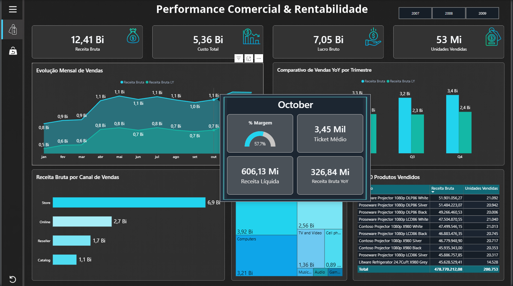

# 📊 Performance Comercial, Rentabilidade & Qualidade (ContosoRetailDW)

Projeto end-to-end de Business Intelligence desenvolvido no **Power BI**, com extração e validação de dados em **SQL Server** (`ContosoRetailDW`), modelagem dimensional em **Star Schema** e indicadores avançados de **Inteligência Temporal em DAX**.

---

## 🎯 Objetivo de Negócio
Fornecer uma visão executiva integrada para acompanhar o faturamento, a margem bruta e o impacto financeiro das devoluções ao longo do tempo, permitindo identificar:
- Sazonalidade mensal e crescimento anual (`YoY` e `MoM`);
- Rentabilidade e volume por canal de venda (*Store*, *Online*, *Reseller*, *Catalog*);
- Categorias e produtos com maior índice de devolução;
- Detalhamento granular por produto via **Drill-Through** sem comprometer a performance do modelo.

---

## 🏗️ Arquitetura & Modelagem de Dados (Star Schema)
Para garantir alta performance em uma tabela fato com mais de **3,4 milhões de registros** (`fat_Vendas`), os dados foram estruturados em **Esquema Estrela (Star Schema)** com relacionamentos `1:N` unidirecionais e chaves técnicas ocultadas:

- **Fato:** `fat_Vendas` (métricas transacionais de receita, custo, quantidade vendida e devolvida)
- **Dimensões:** `dim_Calendario`, `dim_Produto` e `dim_Canal`
- **Grupos de Medidas:** `#Medidas` (indicadores base e dinâmicos) e `#Medidas_Inteligencia Temporal` (`LM`, `LY`, `MoM`, `MoM %`, `YoY`, `YoY %`, `YTD`)

---

## 🖥️ Páginas & Recursos de UX Implementados

### 1. Performance Comercial & Rentabilidade (Paleta Ciano)
Visão macro de **Receita Bruta (12,41 Bi)**, **Custo Total (5,36 Bi)**, **Lucro Bruto (7,05 Bi)** e **Unidades Vendidas (53 Mi)**, acompanhada de evolução mensal (`Receita Bruta` vs. `LY`), comparativo trimestral, distribuição por canal, Treemap de categorias e ranking **Top 10 Produtos Vendidos**.

### 2. Qualidade & Análise de Devoluções (Paleta Âmbar/Coral)
Painel dedicado ao monitoramento de perdas e qualidade: **Total Devoluções (156,84 Mi)**, **% Devoluções (1,3%)**, **Unidades Devolvidas (494 Mil)** e **Unidades Devolvidas % (0,9%)**, destacando categorias críticas como *Home Appliances* (1,5%) e o ranking **Top 10 Produtos com Maior Devolução**.

### 3. Tooltips Customizadas & Drill-Through
- **Tooltips Contextuais:** Caixas flutuantes compactas com títulos dinâmicos (`COALESCE` + `SELECTEDVALUE`), exibindo métricas complementares como `% Margem` (com medidor visual), `Ticket Médio`, `Receita Líquida` e variações `YoY`.
- **Drill-Through de Auditoria:** Acesso rápido via clique direito sobre qualquer produto, canal ou categoria, filtrando instantaneamente o desempenho histórico e por canal do item selecionado.

| Tooltip Contextual | Detalhamento (Drill-Through) |
| :---: | :---: |
|  |  |

### 4. Navegação & Painel Retrátil de Filtros
Menu lateral inspirado em aplicações web utilizando **Indicadores (Bookmarks)** e **Painel de Seleção** para expandir/recolher uma gaveta lateral com filtros hierárquicos (`Ano/Mês`, `Canal`, `Marca`, `Categoria/Subcategoria` e `Produto`), além de seletor rápido de anos no cabeçalho e botão global de reset de filtros.

---

## 🛠️ Stack Tecnológica
- **SQL Server (T-SQL):** Extração, tratamento e auditoria de consistência da base `ContosoRetailDW`
- **Power BI Desktop:** ETL com Power Query (M), Modelagem Star Schema, DAX e UI/UX Design
- **Figma / SVG:** Criação de backgrounds customizados em Dark Mode e ícones temáticos
