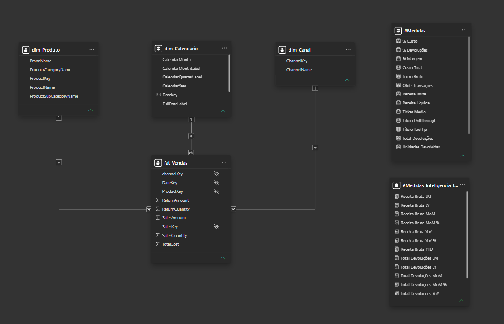
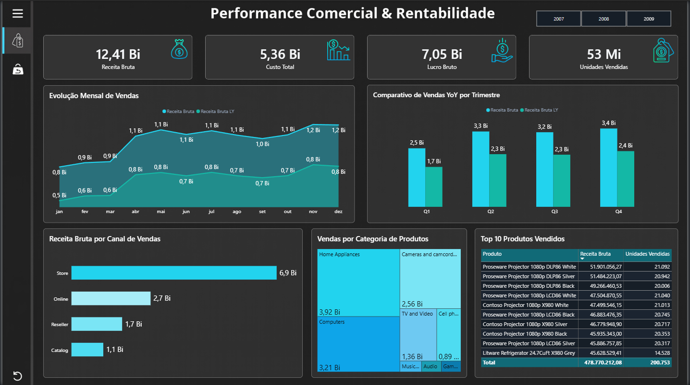
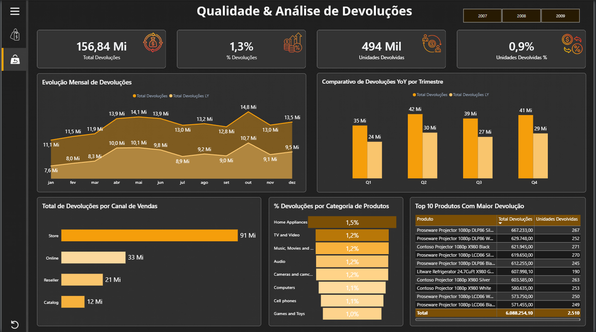
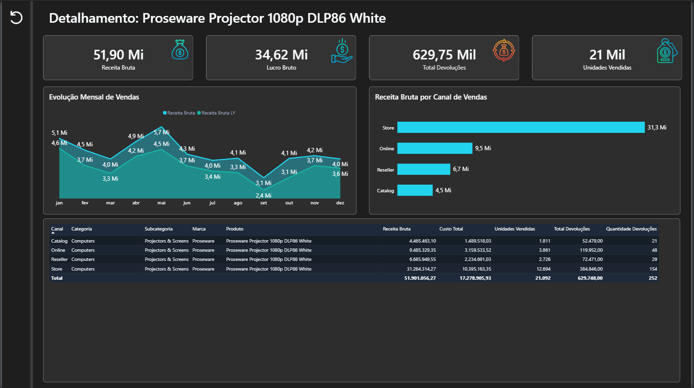

# 📊 Performance Comercial, Rentabilidade & Qualidade — Contoso Retail DW

Utilizando o banco de dados **ContosoRetailDW**, empresa fictícia global do setor varejista, iniciei uma análise completa para compreender a evolução comercial, a rentabilidade operacional e o comportamento das devoluções entre **2007 e 2009**. O objetivo principal do projeto é conduzir uma análise exploratória e diagnóstica das vendas da Contoso, entendendo onde está concentrado o faturamento, como os canais e categorias performam ao longo do tempo e onde está o maior impacto financeiro por devoluções.

Fazendo o download do arquivo `ContosoRetailDW.bak` e restaurando-o no SQL Server, é possível executar cada consulta SQL utilizada nesta etapa de auditoria e obter exatamente os mesmos resultados apresentados no relatório.

---

## 🔗 Acesso Rápido ao Projeto
- 🌐 **[Clique aqui e acesse o Dashboard Interativo Online (Power BI Service)](https://app.powerbi.com/view?r=eyJrIjoiYjNmZGMyM2UtYmRiZS00N2MwLWEyMmYtMzMwZTIyMDgyNmQ1IiwidCI6IjY1OWNlMmI4LTA3MTQtNDE5OC04YzM4LWRjOWI2MGFhYmI1NyJ9)**
- 📁 **[Clique aqui e acesse o arquivo `.pbix` no GitHub](SalesContosoRetail.pbix)**
- 🗄️ **[Clique aqui e acesse os scripts SQL no GitHub](SQL/ContosoRetail_Validacao.sql)**

---

## 🔍 1. Análise Exploratória e Validação de Dados (SQL Server)

Iniciei o projeto mapeando cada objeto, tabela fato e dimensão, tipos de dados e relacionamentos do modelo de dados `ContosoRetailDW`. Após identificar a tabela transacional de vendas (`FactSales`) com mais de **3,4 milhões de registros** e suas dimensões (`DimProduct`, `DimDate`, `DimChannel`), desenvolvi scripts em T-SQL para explorar e auditar a consistência dos dados antes de qualquer visualização:

- Receita Bruta, Custo Total, Lucro Bruto e Margem Operacional
- Volume de vendas e devoluções por ano, trimestre e mês
- Participação e faturamento por canal de venda (*Store*, *Online*, *Reseller* e *Catalog*)
- Ranking de produtos mais vendidos e produtos com maior índice de devolução
- Indicadores de eficiência, como Ticket Médio e percentual de impacto financeiro por devolução

---

## 📈 2. Evolução Comercial e Rentabilidade entre Períodos

Ao aprofundar a análise temporal comparando períodos (`YoY` — *Year over Year* e `MoM` — *Month over Month*), consolidamos o desempenho comercial da companhia e identificamos os principais vetores de crescimento:

- **Resultado Consolidado:** A operação acumulou **12,41 Bi** em Receita Bruta e **7,05 Bi** em Lucro Bruto, mantendo uma margem operacional média de **56,8%** no período analisado.
- **Força dos Canais Físicos:** O canal **Store** concentra a maior fatia do faturamento com **6,9 Bi** (mais de 55% da receita total), seguido por **Online** (**2,7 Bi**), **Reseller** (**1,7 Bi**) e **Catalog** (**1,1 Bi**).
- **Sazonalidade e Trimestres:** O faturamento acelera consistentemente a partir de abril e atinge seu ápice no último trimestre (**Q4** com **3,4 Bi**), superando o ano anterior em todos os trimestres.
- **Liderança por Categoria:** **Home Appliances** (**3,92 Bi**), **Computers** (**3,21 Bi**) e **Cameras and camcorders** (**2,56 Bi**) representam o núcleo principal de receita da empresa.

---

## ⚠️ 3. Diagnóstico de Qualidade e Impacto das Devoluções

Para avaliar a eficiência real da operação além do faturamento bruto, cruzamos os registros de retorno (`ReturnAmount` e `ReturnQuantity`) para mapear perdas e ofensores de margem:

- **Impacto Financeiro:** As devoluções totalizaram **156,84 Mi** (**494 mil unidades devolvidas**), representando **1,3%** sobre a receita bruta total.
- **Concentração e Sazonalidade:** Assim como nas vendas, o canal **Store** lidera o volume absoluto de devoluções (**91 Mi**), com pico sazonal registrado no mês de outubro (**14,8 Mi**).
- **Ofensores Críticos:** A categoria **Home Appliances** apresentou a maior taxa proporcional de devolução (**1,5%**), enquanto a linha de projetores (como *Proseware Projector 1080p DLP86*) aparece simultaneamente entre os campeões de venda e no topo do ranking de devoluções — um alerta claro de qualidade ou expectativa de produto.

---

## 💡 Conclusão Técnica: SQL vs. Power BI

Com o SQL, conseguimos extrair, tratar, manipular e auditar milhões de linhas diretamente na fonte de dados de forma simples e rápida. Porém, o SQL não é uma ferramenta visual dinâmica: a cada nova pergunta de negócio — como filtrar um canal específico, isolar um trimestre ou investigar um único produto — é necessário reescrever consultas e interpretar resultados estáticos em formato de tabela.

A conclusão prática deste projeto é que o **SQL é indispensável como etapa de fundação e auditoria** para validar os números na origem antes de escolher uma ferramenta de visualização. Uma vez garantida a integridade dos dados no banco, o **Power BI** assume o protagonismo ao permitir análises visuais interativas, dinâmicas e autônomas para a tomada de decisão.

---

## 📊 4. Dashboard Power BI & Arquitetura do Projeto

Seguindo essa ideia, estruturei um relatório executivo end-to-end no Power BI modelado em **Star Schema** (`fat_Vendas` conectada às dimensões `dim_Produto`, `dim_Calendario` e `dim_Canal`), com medidas organizadas em grupos temáticos (`#Medidas` e `#Medidas_Inteligencia Temporal`) para garantir alta performance mesmo sobre milhões de registros.

### 🖥️ Páginas e Recursos Implementados

#### 1. Performance Comercial & Rentabilidade (Paleta Ciano)
Visão executiva de faturamento, custos, lucro e comparativos `YoY` mensais e trimestrais, acompanhada de distribuição por canal, Treemap de categorias, ranking **Top 10 Produtos Vendidos** e seletor rápido de anos no cabeçalho.

#### 2. Qualidade & Análise de Devoluções (Paleta Âmbar/Coral)
Painel dedicado ao monitoramento de perdas financeiras, taxas de retorno (`% Devoluções` e `Unidades Devolvidas %`), evolução sazonal e ranking dos 10 produtos com maior volume devolvido.

#### 3. Tooltips Customizadas & Drill-Through de Auditoria
- **Tooltips Contextuais:** Caixas flutuantes com títulos dinâmicos (`COALESCE` + `SELECTEDVALUE`), revelando métricas complementares (`% Margem` com medidor visual, `Ticket Médio`, `Receita Líquida` e variações `YoY`) ao passar o mouse sobre os gráficos.
- **Drill-Through:** Detalhamento granular por produto, categoria ou canal com um clique, exibindo o histórico mensal e a quebra por canal do item selecionado sem comprometer a performance.
- **Menu Retrátil de Filtros:** Gaveta lateral construída com *Bookmarks* e Painel de Seleção para aplicar filtros hierárquicos (`Ano/Mês`, `Canal`, `Marca`, `Categoria/Subcategoria` e `Produto`) e resetar a visão com um clique.

| Tooltip Contextual | Detalhamento (Drill-Through) |
| :---: | :---: |
|  |  |

## 🛠️ Ferramentas e Linguagens Utilizadas

- **SQL Server (T-SQL):** Exploração, tratamento e validação de regras de negócio na base `ContosoRetailDW`
- **Power BI Desktop:** Modelagem dimensional (*Star Schema*), ETL com Power Query (M) e visualização de dados
- **DAX (Data Analysis Expressions):** Criação de medidas de rentabilidade, inteligência temporal (`YoY`, `MoM`, `LY`, `LM`) e títulos dinâmicos
---

  
  

